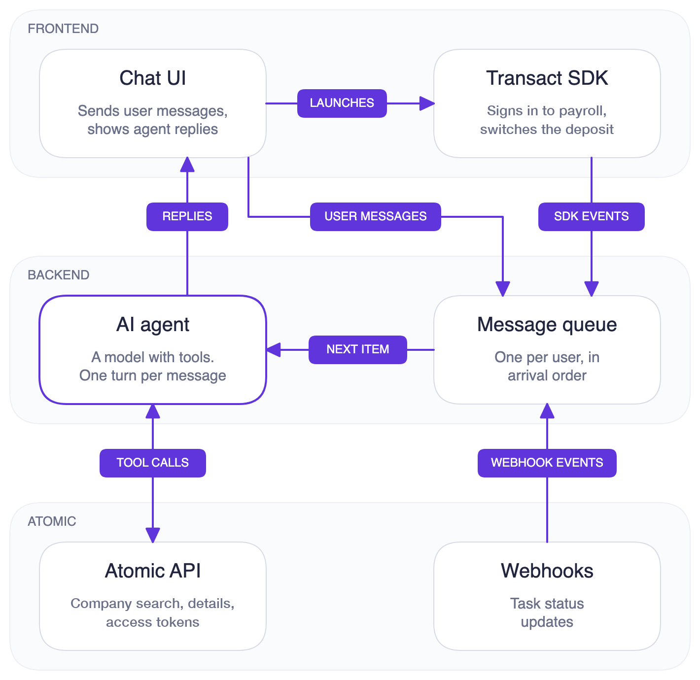

# Direct Deposit Assistant: Atomic + an AI agent

A deliberately small example of how an AI agent can use the [Atomic](https://atomicfi.com) API and Transact SDK to help a user move their paycheck's direct deposit to a new bank account, using Atomic's [Deposit](https://docs.atomicfi.com/products/deposit/implementation) product.

The user chats with an assistant in a mobile app. The agent works out which employer or payroll provider pays them, by searching Atomic's company directory and asking follow-up questions: which franchisee runs their location, which of several payroll systems their employer uses, or which employer's Workday they sign in to. Once it has the company (and the payroll system, when there's a choice), the agent puts a button in the app that opens Atomic's Transact SDK straight on that company's sign-in. The user signs in to their payroll account there and makes the switch. Atomic's webhooks and the SDK's events go back to the agent, so it can tell the user how things went without being asked.

The example can be deployed, but the goal is to show, as simply as possible, how an AI agent can work with Atomic's API, SDK and webhooks. Some things are left out for that reason: there's no login, state lives in memory or a local SQLite file, and webhooks aren't verified. Each of those is a place where a real integration would do more.

## Tech stack

| Part | What it uses |
| --- | --- |
| Agent | [LangChain](https://js.langchain.com) `createAgent` with Claude (`claude-opus-5-5`) through `@langchain/anthropic`. Conversation memory is LangGraph's in-memory `MemorySaver`. |
| Server | Node.js 22+ and Express 5, a WebSocket server (`ws`), and SQLite through Node's built-in `node:sqlite` for webhook events. |
| Atomic | The Atomic API, called from the server with your API key and secret, and the Transact SDK, opened in the app with a public token. |
| Mobile app | Expo (SDK 57) / React Native with `@atomicfi/transact-react-native`. It needs a development build because the Transact SDK has native code, so Expo Go won't run it. |

## Architecture

Everything the agent responds to goes through one queue. Three things write to it: the user, Atomic's webhooks, and the Transact SDK's events. The agent takes items off the queue one at a time for each user and sends each reply to the app over a WebSocket.

<picture>
  <source media="(prefers-color-scheme: dark)" srcset="docs/architecture-dark.png">
  
</picture>

- **The user's messages** go to `POST /user-message`, and the server queues them.
- **Transact SDK events**: when the user leaves the Atomic screen, the app sends the SDK's `onFinish` or `onClose` payload to `POST /transact-events`, with the `taskId` when Transact created a task. The server queues it as a system event, so the agent can follow up: after a close, it tells the user a switch they started is under way. If a webhook for that task has already arrived, the agent has already told the user, so the server skips the close.
- **Atomic webhooks** arrive at `POST /webhooks/atomic/deposit-agent`. Each `task-status-updated` event for the `deposit` product is saved to SQLite as its own row, raw payload included, so a task's whole history is kept. The server also queues it for the agent, with its `taskId`: `processing` when the task starts, then `completed` or `failed`, with the failure reason or how much of the paycheck moved. Atomic can deliver an event more than once, and a task's events out of order, so the server skips a repeat, and a `processing` that arrives after the task finished.
- **The agent** sees system events as `<system_event type="…">` messages the user never sees. Its system prompt says how to respond to each type.
- **Replies** go to the app over the WebSocket, along with `busy` (for the typing indicator) and `error` events. Each user has one thread, keyed by their user ID.

When the agent wants the app to open Transact, a tool returns a `launch_transact` *client action* alongside its result. It travels with the agent's reply, and the app shows it as a button. The model only learns that the button is ready; it never sees the launch configuration.

### Where things live

```
agent/          The agent: model, system prompt, tools
  tools/        One file per tool
atomic/         A small client for the Atomic API
server/
  index.js      Express app and WebSocket server
  queue.js      Per-thread message queue; runs the agent's turns
  bus.js        Sends events to the WebSockets listening on a thread
  db.js         SQLite: the test user, their bank accounts and stored webhook events
  routes/       /user-message, /transact-events, /webhooks/atomic/deposit-agent
mobile/         Expo app: chat screen, API client, Transact launcher
```

## Tools

The agent has five tools. Each runs on the server, so Atomic credentials never reach the model or the app.

| Tool | What it does | Atomic API |
| --- | --- | --- |
| `find_payroll_accounts` | Looks the user up by identity in the payroll systems Atomic has CoAuth partnerships with (ADP today). A user found there can switch by confirming a code from their payroll system instead of signing in. Called once the user asks to move their deposit. The identity comes from `getUserIdentity` in [server/db.js](server/db.js) and never reaches the model. | `POST /pre-screen` |
| `search_companies` | Searches for employers, payroll providers and gig platforms where a direct deposit can be switched. Can narrow to the employers on one payroll system (`connectorId`) or the franchisees under one brand (`franchiseParent`). | `POST /company/search` |
| `get_company_details` | Says whether a switch is available right now, whether part of the paycheck can move or only all of it, and which payroll systems the company runs on, including whether its sign-in is per employer. | `GET /company/:companyId/details` |
| `get_deposit_config` | Checks that the company, and the payroll system when one was chosen, support deposit, then creates a public token and gives the app an "Update Deposit" button, with the company's logo. Creating the token also registers the user with Atomic. It opens Transact on a `deposit` task, with the amount the user confirmed in the chat if any, deeplinked to the company's sign-in, and to a specific payroll system when the user chose one or named it (such as Workday). | `GET /company/:companyId/details`, `POST /access-token` |
| `check_events` | Reads each task's current status from the stored webhooks, to tell the user whether a switch went through. The agent matches the task to the switch by the `taskId` from Transact. | None. It reads the local database. |

The bank account the paycheck goes to comes from `getUserAccounts` in [server/db.js](server/db.js), which `get_deposit_config` calls before creating an access token. It returns Atomic's example account, which works in the sandbox; in a real app it's the user's own account at your bank, and the model never sees it.

The user's identity for CoAuth comes from `getUserIdentity` in the same file. It returns Atomic's sandbox test user who is found at ADP; in a real app it's the identity details your bank already holds. `find_payroll_accounts` sends it to `POST /pre-screen`, and `get_deposit_config` adds it to the access token, so Transact uses CoAuth for that payroll system and verifies the user with a code instead of a password. Return `null` for a user without identity data and the agent skips CoAuth. See the [CoAuth guide](https://docs.atomicfi.com/integrations/co-auth).

### The Transact config

`get_deposit_config` sends the app this config, which the app passes to `Atomic.transact`:

```js
{
  scope: 'user-link',
  publicToken,
  tasks: [{ operation: 'deposit', distribution }], // distribution only when the user confirmed an amount
  deeplink: { step: 'login-company', companyId, connectorId } // connectorId only when the user chose or named a payroll system
}
```

When the user has confirmed an amount with the agent, the task carries it: `distribution: { type, amount, canUpdate }`. The agent only offers splits that both the payroll system (its `distributionTypes`) and your bank allow, and the server checks them again before making the button. Your bank's side comes from [server/deposit-settings.js](server/deposit-settings.js): set `FRACTIONAL_DEPOSITS` and `DEPOSIT_AMOUNT_CAN_UPDATE` in `.env` to match the Fractional Deposits settings on your Atomic account, since the API doesn't return them. `canUpdate` is off by default, so the user can't change in Transact the amount they agreed to in the chat. Without a confirmed amount, no `distribution` is set, and the user chooses in Transact when their payroll system allows a choice. See the [Transact SDK reference](https://docs.atomicfi.com/reference/transact-sdk).

## Running it locally

The project uses **Atomic's sandbox by default**. `.env.example` points at `https://sandbox-api.atomicfi.com`, and the Transact SDK uses the same environment.

### What you need

- **Node.js 22.13 or later**, with npm
- **macOS with Xcode** and an iOS simulator running iOS 16.4 or later, plus CocoaPods, to build the app. It has been built with Xcode 27.0 and CocoaPods 1.16.2. The app is iOS only: there's an `android` script, but it hasn't been built or tested for Android. It needs a native build because the Transact SDK has native code, so Expo Go won't run it.
- **Ports 3000 and 8081 free**, for the server and Metro. If another dev server is on port 3000, the app's requests reach it instead and fail with a 404. To use a different port, start the server with `PORT=3001 npm run dev` and set `EXPO_PUBLIC_API_URL` in `mobile/.env` to match, then restart Metro with `npx expo start -c` so the app picks it up.
- **An Atomic account**, to get sandbox API keys from the Atomic console. If you don't have one, contact Atomic to get set up. Besides company search, company details and access tokens, the keys need access to list API secrets and to create and delete webhook endpoints, for the automatic webhook setup.
- **An Anthropic account**, to get an API key from the [Claude Console](https://console.anthropic.com/settings/keys)
- **An [ngrok](https://ngrok.com) account**, for the authtoken the server uses to open a tunnel so Atomic's webhooks can reach your machine. A free account works, and you don't need the ngrok CLI.

### 1. Install

```sh
npm install
cd mobile && npm install && cd ..
```

### 2. Configure

Copy the example env file and fill in your keys:

```sh
cp .env.example .env
```

```sh
ANTHROPIC_API_KEY=sk-ant-...
ATOMIC_API_BASE_URL=https://sandbox-api.atomicfi.com
ATOMIC_API_KEY=...       # sandbox key from the Atomic console
ATOMIC_API_SECRET=...    # sandbox secret from the Atomic console
USER_IDENTIFIER=...      # required: the user every chat acts as, such as test-user-1
NGROK_AUTHTOKEN=...      # from the ngrok dashboard
NGROK_DOMAIN=            # optional: a reserved domain on a paid ngrok plan
```

All of these except `NGROK_DOMAIN` are required. If any is missing, the server stops at startup and lists the ones it needs.

Tell the app where the server is in `mobile/.env`:

```sh
# localhost works in the iOS simulator; on a real device use your Mac's LAN IP.
EXPO_PUBLIC_API_URL=http://localhost:3000
```

### 3. Start the server

```sh
npm run dev
```

It listens on `http://localhost:3000` and creates `data.db` with one test user, `USER_IDENTIFIER` from `.env`. Every chat acts as that user. It also opens an ngrok tunnel and points Atomic's webhooks at it; see step 5.

### 4. Start the app

In another terminal:

```sh
npm run ios
```

This builds the app, installs it on the simulator and starts Metro. The first build takes a few minutes. The header shows **Online** once the app's WebSocket connects.

### 5. Receive webhooks

Webhooks are how the agent learns whether a deposit switch went through. The Transact SDK's events only say that the user left the Atomic screen, not how the task ended. Without webhooks, the agent can't confirm any outcome.

The server sets them up for you when it starts:

1. It opens an ngrok tunnel to itself, using `NGROK_AUTHTOKEN`. The tunnel gets a new URL every time, unless you set `NGROK_DOMAIN` to a domain reserved on a paid ngrok plan.
2. It creates a new endpoint at `<tunnel URL>/webhooks/atomic/deposit-agent` for `task-status-updated`, signed with your API secret named `default`, or your first secret if none has that name.

When the server stops, with Ctrl+C or when `npm run dev` restarts it after a change, it deletes the endpoint it created. If it's killed outright, the endpoint stays in Atomic, and you can delete it in the Atomic console.

The log shows the tunnel and the endpoint it registered. If any step fails, the server logs an error starting with `[ngrok]` or `[webhooks]`. The app still starts, but the agent won't hear when a switch finishes.

To try the flow without Atomic, you can send a webhook yourself while the app is open:

```sh
curl -X POST localhost:3000/webhooks/atomic/deposit-agent -H 'content-type: application/json' -d '{
  "eventType": "task-status-updated", "product": "deposit", "task": "demo-task-1",
  "user": { "identifier": "<your USER_IDENTIFIER>" }, "company": { "_id": "demo", "name": "Mocky" },
  "data": { "status": "completed", "distributionType": "fixed", "distributionAmount": 25 }
}'
```

The agent's message should appear in the chat a few seconds later.
